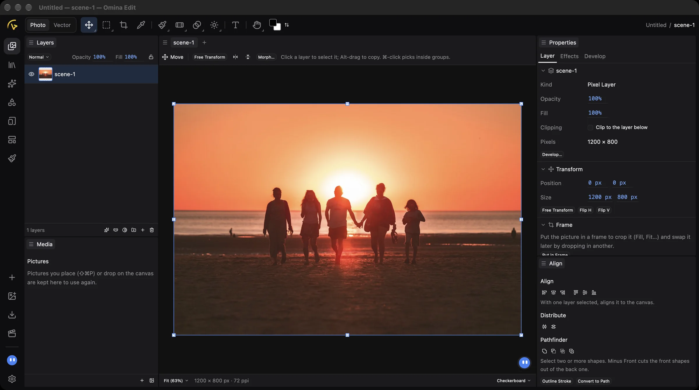
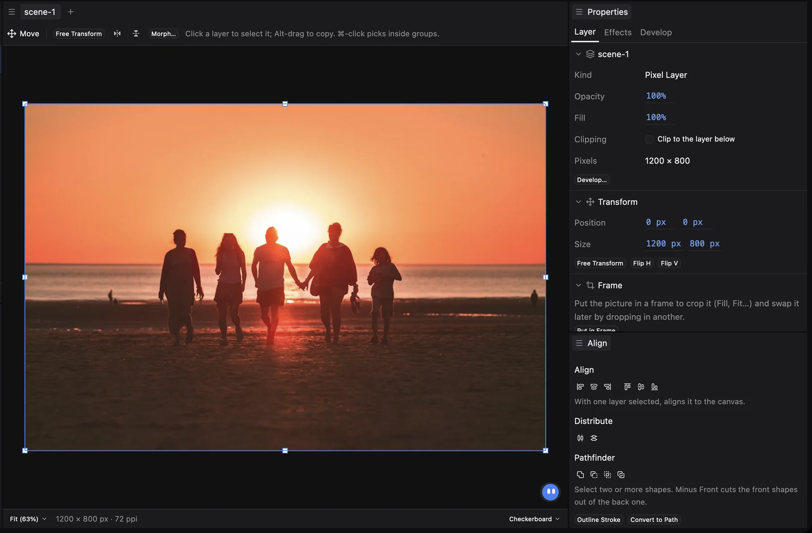

<div align="center">


# Omina Edit

**Photo editing, painting and vector design in one app.**<br>
Retouch, paint and design in the same document.

[](https://github.com/OddOmens/Omina-Edit/releases/latest)
[](LICENSE)


**Download:**
[macOS](https://github.com/OddOmens/Omina-Edit/releases/latest/download/Omina-Edit-macOS.dmg) ·
[Windows](https://github.com/OddOmens/Omina-Edit/releases/latest/download/Omina-Edit-Windows-Setup.exe) ·
[Linux](https://github.com/OddOmens/Omina-Edit/releases/latest/download/Omina-Edit-Linux.AppImage)
&nbsp;|&nbsp; [Release notes](https://github.com/OddOmens/Omina-Edit/releases)

<br>



</div>

<br>

Omina Edit puts Photoshop-style layers, selections, brushes and retouching beside Illustrator-style shapes,
paths and Pathfinder. Pixel and vector layers sit side by side, so a photo and the type around it live in
the same file. If you know Photoshop or Illustrator, the tools and keyboard shortcuts are where you expect.

Part of the Omina family, with [Omina Motion](https://github.com/OddOmens/Omina-Motion) for video and motion
graphics, and [Omina Develop](https://github.com/OddOmens/Omina-Develop) for photo development.

## Contents

- [What it does](#what-it-does)
- [Install](#install)
- [Privacy](#privacy)
- [Build from source](#build-from-source)
- [License](#license)

## What it does

| | |
|---|---|
| 🖌️ **Tools your hands know** | Marquees, lassos, magic wand, brushes, pencil, eraser, gradient and paint bucket. |
| 🩹 **Retouch** | Spot healing, healing, clone stamp, blur, sharpen, smudge, dodge, burn and sponge. |
| 🗂️ **Real layers** | Masks, clipping masks, adjustment layers, groups, every Photoshop blend mode, and layer styles such as shadows, glows and strokes. |
| ✒️ **Vector paths** | Shapes and pen paths that stay sharp at any zoom, combined with Pathfinder, and SVG in and out. |
| 🔤 **Type** | Text in your system fonts, with fills, strokes and stroke options, favorite fonts and brand fonts. |
| 🪄 **Filters with a live preview** | Adjust a filter and watch the canvas before you apply it, plus Lightroom-style Develop settings for photos. |
| ✂️ **Remove backgrounds** | Click a subject and it's cut out, on your own computer. |
| 🧩 **Start fast** | Templates, mockups and elements, plus brand libraries shared with Omina Motion. |
| 💬 **Iris** | A built-in helper that spots things worth fixing in a design, fixes them in a click, and answers questions. It follows plain rules, not AI, and can be turned off. |
| 📤 **Export** | PNG, JPEG, WebP, TIFF, BMP, SVG and PDF. |

<p align="center">
  
  <br><sub>A photo layer with its properties, transform and Pathfinder tools.</sub>
</p>

### Projects

Projects are saved as **`.omie`** files, which open in Omina Edit with a double-click. Projects saved with
the older `.canvas` extension still open.

## Install

Download the file for your system from the [latest release](https://github.com/OddOmens/Omina-Edit/releases/latest).

| System | Needs | First launch |
|---|---|---|
| **macOS** | macOS 13 or later, Apple silicon | The app isn't signed with an Apple Developer ID yet, so macOS asks once. Open the app, close the warning, then go to **System Settings ▸ Privacy & Security** and choose **Open Anyway**. |
| **Windows** | Windows 10 or 11, 64-bit | The installer isn't signed yet, so Windows may warn you. Choose **More info**, then **Run anyway**. |
| **Linux** | A 64-bit (x86-64) desktop | Make the AppImage executable (`chmod +x`, or **Properties ▸ Permissions**), then open it. |

## Privacy

- **No accounts, no telemetry, no analytics.**
- **Background removal runs locally.** Its model downloads once, after asking, and runs on your own computer.
- **Update checks**, when a build has them, are a plain request for a small file, with nothing about you in it.

## Build from source

You need [Rust](https://rustup.rs). Omina Edit shares some code (Iris and background removal) with
Omina Motion, so check both out side by side:

```bash
mkdir "Omina Studio" && cd "Omina Studio"
git clone https://github.com/OddOmens/Omina-Edit.git "Omina Edit"
git clone https://github.com/OddOmens/Omina-Motion.git "Omina Motion"
cd "Omina Edit"
```

```bash
cargo run -p canvas --release   # run the app
cargo test --workspace          # run every test
```

The [developer guide](docs/ARCHITECTURE.md) explains how the code is organized and the conventions it follows.
Pushing a version tag (`v1.2.3`) builds the macOS, Windows and Linux installers and attaches them to that release.

## License

Omina Edit is free software under the [GNU General Public License, version 3 or later](LICENSE).
